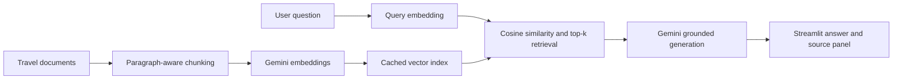

# Sopheaknita Travel AI

A ChatGPT-style travel agency assistant built as a Retrieval-Augmented Generation system for CS382.

The app uses:

- Streamlit for the interface
- Gemini embeddings for semantic retrieval
- Cosine similarity for ranking
- Gemini Interactions API for grounded answer generation
- Visible source chunks and similarity scores
- Graceful failure when the documents do not contain enough information

## Project architecture



## How this upgrades the Week 14 sample

The Week 14 recommender used TF-IDF and cosine similarity. This project keeps cosine similarity and ranking, then replaces TF-IDF with semantic embeddings. It also adds document ingestion, chunking, an LLM generation step, citations, failure handling, caching, and a complete interface.

## Quick start

1. Install Python 3.10 or newer.
2. Open a terminal in this project folder.
3. Create a virtual environment.

Windows:

```bash
python -m venv .venv
.venv\Scripts\activate
```

macOS or Linux:

```bash
python3 -m venv .venv
source .venv/bin/activate
```

4. Install packages.

```bash
pip install -r requirements.txt
```

5. Copy the environment file.

Windows:

```bash
copy .env.example .env
```

macOS or Linux:

```bash
cp .env.example .env
```

6. Open `.env` and replace `paste_your_key_here` with your Google AI Studio API key.
7. Build the index once.

```bash
python scripts/build_index.py
```

8. Run the app.

```bash
streamlit run app.py
```

## Google AI Studio setup

Read `GOOGLE_AI_STUDIO_GUIDE.md` for full instructions.

## Add your own documents

Place `.txt`, `.md`, `.pdf`, or `.csv` files inside `data/travel_docs/`.

The included documents are fictional demo content for testing the software. Replace them with at least 20 real agency documents or an equivalent chunked volume before your final submission. Verify all dates, prices, schedules, visa information, and policies.

The index refreshes automatically when document text or chunk settings change.

## Interface requirements covered

- Header and system name
- Chat input and submit action
- Generated answer panel
- Expandable sources with document name, similarity score, and chunk text
- Adjustable top-k, minimum score, and answer style
- Error handling for missing API key, empty input, no retrieval results, and API failure

## Evaluation

Use `evaluation_queries.csv` and complete `EVALUATION.md` after testing. Record retrieval relevance, citation quality, answer accuracy, latency, and failure behavior.

## Known limitations

- Demo documents are fictional and must not be treated as current travel information.
- The bot does not browse live schedules, prices, weather, or visa websites.
- Gemini API use depends on network access, quota, and billing status.
- In-memory cosine retrieval is suitable for a small academic collection. A larger production system should use a vector database.
- PDF extraction works best on text-based PDFs. Scanned PDFs may require OCR or direct multimodal embedding.
# CS382
# sopheaknita-travel-ai
